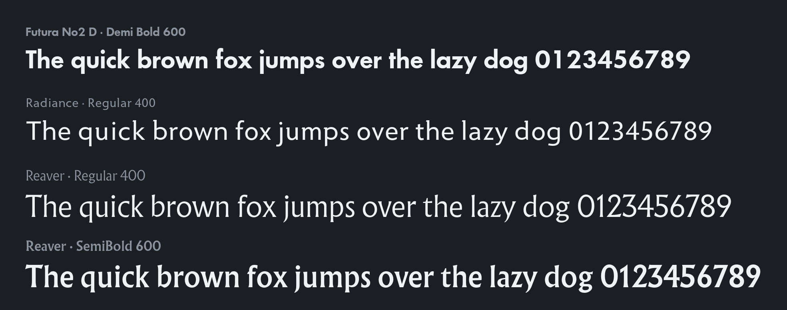

# 🔤 Fonts

Fonts I use across my projects, served through [jsDelivr](https://www.jsdelivr.com/).



## 📦 Files

| Family | Weight | Files |
|---|---|---|
| Futura No2 D | 600 | `futura-no2-demi-bold.ttf`, `.woff2` |
| Radiance | 400 | `radiance-regular.otf`, `.woff2` |
| Reaver | 400 | `reaver-regular.otf`, `.woff2` |
| Reaver | 600 | `reaver-semibold.otf`, `.woff2` |

## 🌐 Web

Link the stylesheet, then use the family names:

```html
<link rel="stylesheet" href="https://cdn.jsdelivr.net/gh/Aluerie/Fonts@1.x/fonts.css">
```

```css
h1 { font-family: "Reaver", serif; font-weight: 600; }
```

`@1.x` always serves the newest `1.x.x` release. Pin an exact version like `@1.1.0` when a page must never change.

To avoid a flash of fallback text, preload the font the page shows first. The URL must match the one in `fonts.css`, and `crossorigin` is required even for public fonts:

```html
<link rel="preload" href="https://cdn.jsdelivr.net/gh/Aluerie/Fonts@1.x/reaver-semibold.woff2" as="font" type="font/woff2" crossorigin>
```

## 🐍 Python (Pillow)

```python
from PIL import ImageFont

font = ImageFont.truetype("reaver-semibold.otf", 32)
```

Pillow needs a local file, so download it first from `https://cdn.jsdelivr.net/gh/Aluerie/Fonts@1.x/<file>`.

## 💻 Local install

Install the `.ttf` / `.otf` files (Windows can't install `.woff2`). Right-click → **Install for all users**, since some apps, OBS included, don't always pick up per-user fonts. Restart the app afterwards.

Installed fonts show up under these names:

| File | Font picker name | CSS `local()` name |
|---|---|---|
| `futura-no2-demi-bold.ttf` | Futura No2 D Demi Bold | `FuturaNo2D-DemiBold` |
| `radiance-regular.otf` | Radiance | `Radiance-Regular` |
| `reaver-regular.otf` | Reaver | `Reaver-Regular` |
| `reaver-semibold.otf` | Reaver SemiBold | `Reaver-SemiBold` |

### 🎬 OBS text source

Add a **Text (GDI+)** source, click **Select Font**, and pick the font by its font picker name from the table.

### 🎨 OBS browser source / custom CSS

Browser sources take CSS in the **Custom CSS** box. The simplest option doesn't need anything installed; it loads the fonts from the CDN (`@import` must be the first line):

```css
@import url("https://cdn.jsdelivr.net/gh/Aluerie/Fonts@1.x/fonts.css");

body { font-family: "Reaver", serif; font-weight: 600; }
```

To use the installed copies instead (works offline), declare them with `local()` and the names from the table:

```css
@font-face {
  font-family: "Reaver";
  src: local("Reaver-SemiBold");
  font-weight: 600;
}

body { font-family: "Reaver", serif; font-weight: 600; }
```

## 🛠️ Build

`build.py` turns the `.ttf` / `.otf` source files into everything else: it sets each font's internal weight, writes the `.woff2` copies, `fonts.css` and `preview.png`. To add a font, drop its source file in the repo, add a line to `FONTS` in `build.py`, and run:

```sh
uv run build.py
```

## 🏷️ Releases

Releases are semver tags (`v1.1.0`, `v1.2.0`, …). After a change, commit, then tag and push:

```sh
git tag v1.2.0
```

```sh
git push origin v1.2.0
```

`@1.x` links pick up the new release within about a week. To update them right away, purge the cache at [jsdelivr.com/tools/purge](https://www.jsdelivr.com/tools/purge). Bump the major version (`v2.0.0`) only for breaking changes, such as renamed files or families; `@1.x` links then stay on the old fonts.

Use `@1.x`, not `@1`: jsDelivr reads the original `v1` tag as version `1`, so `@1` matches that tag exactly instead of the newest `1.x.x`. The `v1` tag is kept so old `@v1` links keep working.

## 🙏 Credits

- Futura No2 D: © (URW)++ Design & Development.
- Radiance and Reaver: © Valve Corporation, designed by YouWorkForThem (Reaver with Nicolas Massi). Licensed only for fan art under the Steam Subscriber Agreement.
